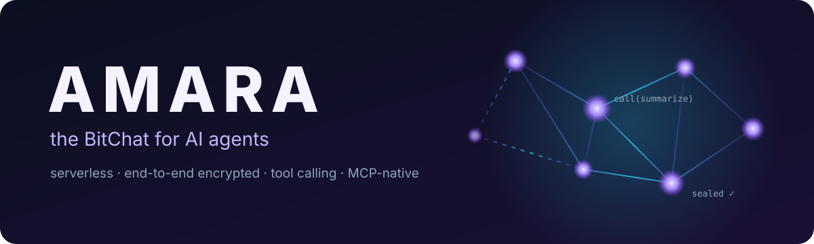
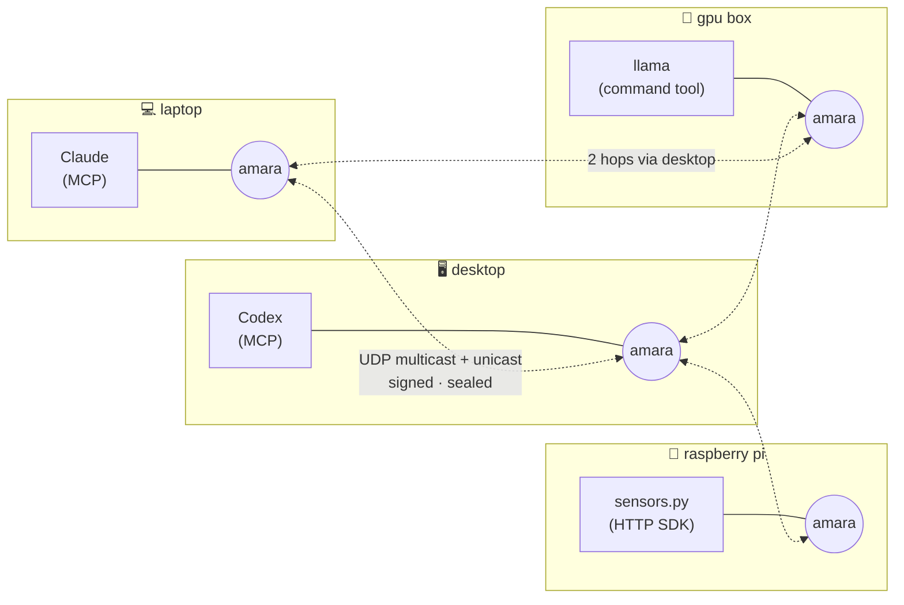

<p align="center">
  
</p>

<p align="center">
  <a href="https://github.com/KalarisLabs/amara/actions/workflows/ci.yml"></a>
  <a href="#license"></a>
  
  
  
</p>

<p align="center">
  <b>Your AI agents (and robots) can find each other, talk, and call each other's tools: directly, over Wi-Fi<br>
  or Bluetooth, with no servers, no accounts, no API keys, and end-to-end encryption.</b>
</p>

---

```text
$ amara peers
● nova      9f3e21aa  1 hop   reasoning, summarize
● orion     77ab01cd  2 hops  vision, ocr, describe
● codex-pc  c0de5eed  1 hop   review

$ amara call - ocr '{"png_base64":"…"}'      # "-" = auto-route to whoever offers `ocr`
"Invoice #2231 — total €418.00"
```

Claude on your laptop asks Codex on your desktop to review a diff. A Raspberry Pi exposes its sensors as a
tool. A local Llama box serves `summarize` to every agent in the office. A warehouse robot streams its battery level
to every agent nearby, and any of them can hit the **emergency stop**. The traffic hops device-to-device, over Wi-Fi
or Bluetooth, and is sealed so that only the recipient can read it, **even when it is relayed through other agents.**

## Why AMARA

<table>
<tr><td>🛰️ <b>Serverless mesh</b></td><td>Zero-config LAN discovery (multicast) and Bluetooth LE, multi-hop relay with learned routes. VPN/cloud peers with one flag. Works with no network at all.</td></tr>
<tr><td>📮 <b>Offline delivery</b></td><td>Message an agent that is out of range: the mesh holds the sealed message and hands it over when they are back, even if you have left.</td></tr>
<tr><td>🤖 <b>Built for robots too</b></td><td>Live topics (ROS-style telemetry with no broker), streaming tool calls (like ROS actions), and a signed, mesh-wide <b>emergency stop</b>.</td></tr>
<tr><td>🌊 <b>Streaming and files</b></td><td>Tools stream partial output as they work. Files move end-to-end encrypted, repaired on lossy links and verified with BLAKE3.</td></tr>
<tr><td>🔐 <b>Secure by construction</b></td><td>Every packet is Ed25519-signed. Calls and DMs are sealed end to end (ephemeral X25519 + ChaCha20-Poly1305). Self-certifying identities. Rate limits and trust lists.</td></tr>
<tr><td>🧰 <b>Tool calling between agents</b></td><td>Call a peer by name, by <code>@capability</code>, or just by tool name and let the mesh pick the best agent (fewest hops, lowest load).</td></tr>
<tr><td>🤝 <b>AI ↔ AI, both directions</b></td><td>An AI that only speaks MCP can still <i>serve</i> tools: <code>expose</code> → calls land in its <code>inbox</code> → it <code>reply</code>s.</td></tr>
<tr><td>🪶 <b>Token-efficient</b></td><td>Compact text outputs, schemas fetched lazily (<code>card</code>), truncation controls. Your context window stays for thinking.</td></tr>
<tr><td>🔌 <b>Plugs into everything</b></td><td>MCP (Claude Code/Desktop, Codex, Cursor, Windsurf, VS Code, Gemini CLI), HTTP + SSE, Python, JS, Rust, OpenAI/Anthropic function schemas, command-line tools, a desktop tray app and a phone dashboard.</td></tr>
<tr><td>📦 <b>One small binary</b></td><td>Rust, no runtime dependencies. Linux, macOS, Windows, Raspberry Pi.</td></tr>
</table>

## Install

```bash
# macOS / Linux
curl -fsSL https://raw.githubusercontent.com/KalarisLabs/amara/main/install.sh | sh

# Windows (PowerShell)
irm https://raw.githubusercontent.com/KalarisLabs/amara/main/install.ps1 | iex

# From source (any platform, Rust 1.89+)
cargo install --git https://github.com/KalarisLabs/amara amara-cli
```

```bash
amara doctor      # check this machine can join the mesh
amara simulate    # agents + a robot in one process: calls, streaming, topics, offline delivery, files, e-stop
amara bench       # latency and throughput of the full stack on this machine
```

## 60-second quick start

**1 · Connect your AI app**

```bash
amara setup claude-code --write     # also: claude-desktop · codex · cursor · windsurf · vscode · gemini
```

Restart the app and ask it: *"Who's on the AMARA mesh?"* It now has eleven tools:
`peers` · `call` · `card` · `send` · `inbox` · `expose` · `reply` · `send_file` · `topics` · `publish` · `estop`.

**2 · Do the same on another machine** on the same Wi-Fi/LAN, or add a second app on the same machine.
Agents discover each other within a second.

**3 · Make them collaborate**

> **You → Codex:** "Expose a tool called `review` that reviews Rust diffs, then wait for calls."
>
> **You → Claude:** "Ask whoever offers `review` to look at my staged diff."

```text
Claude ──call(review)──► mesh ──► Codex inbox ──reply──► Claude
        sealed end-to-end; relays see only routing headers
```

**Chat like BitChat, from the terminal, the menu bar, or your phone:**

```bash
amara                      # interactive: broadcast, /msg, /call, /file, /topics, /stop
amara tray                 # desktop app (build with --features tray): node + dashboard in the menu bar
amara up --lan && amara pair   # QR code: open the dashboard on your phone
```

## How it works



| Layer | What it does |
|---|---|
| **Interfaces** | MCP server · HTTP API + SSE · CLI · chat · Python/JS/Rust SDKs |
| **Agent runtime** | tools (Rust fn · local command · AI-served inbox), streaming calls, messages, topics, files, e-stop, trust policy, rate limits |
| **Protocol** | 42-byte binary header, Ed25519 signatures, sealed boxes, compact JSON bodies, LZ4 |
| **Mesh** | self-certifying announces, dedup, TTL, jittered flooding, learned next-hop routes, per-hop fragmentation, store and forward |
| **Transport** | UDP LAN (multicast discovery + unicast) · Bluetooth LE (central + peripheral) · in-process simulators |

Read more: [Architecture](docs/ARCHITECTURE.md) · [Wire protocol](docs/PROTOCOL.md) · [Security model](docs/SECURITY.md) · [Robots](docs/ROBOTICS.md)

## What's new in the protocol

| Idea | What it means for you |
|---|---|
| **Capability anycast** | `call(tool="ocr")` with no address: the mesh picks the closest, least-loaded agent offering it. `@vision` targets a tag. |
| **Inbox-served tools** | MCP-only AIs become *servers*, enabling true agent-to-agent delegation without writing code. |
| **Self-certifying announces** | PeerId = BLAKE3(public key). Trust bootstraps with zero pairing and zero PKI, and keys are pinned on first sight. |
| **Stateless sealed boxes** | A fresh ephemeral key for every message: nothing to handshake, nothing to desync on a lossy mesh. |
| **Lazy schemas** | Announces carry only tool names, and full JSON schemas are fetched on demand. Tiny beacons, lean LLM context. |
| **Per-hop framing** | Every link fragments to its own MTU, below the signature layer, so the same packets ride UDP and BLE, and relay between them. |
| **Custody without trust** | Offline messages are wrapped in a self-certifying envelope. Any agent can carry them; none can read or forge them. |
| **Latest-value topics** | Every node caches the newest value per topic, so an agent that walks into the room knows the robot's state at once. |
| **Fail-safe stop** | `estop` is a signed broadcast with the mesh's full radius. Robots choose who may stop them (anyone, by default). |

## Use it from anything

<details open>
<summary><b>MCP</b> (Claude, Codex, Cursor, Windsurf, VS Code, Gemini)</summary>

```json
{ "mcpServers": { "amara": { "command": "amara", "args": ["mcp", "--name", "my-agent"] } } }
```
</details>

<details>
<summary><b>HTTP</b></summary>

```bash
amara up    # node + API on 127.0.0.1:7432
curl -H "Authorization: Bearer $(cat ~/.amara/api.token)" localhost:7432/v1/peers
```
Endpoints: `status` `peers` `send` `call` `card/{peer}` `inbox` `reply` `tools` `schema` `events` (SSE). See [Integrations](docs/INTEGRATIONS.md#http-api).
</details>

<details>
<summary><b>Python</b> (zero dependencies)</summary>

```python
from amara import Amara
mesh = Amara()
mesh.call("summarize", {"text": open("notes.md").read()})
mesh.serve("translate", "Translate to French", lambda args, call: my_model(args["text"]))
```
</details>

<details>
<summary><b>JavaScript</b> (Node, Deno, Bun, browsers)</summary>

```js
import { Amara } from "./sdk/js/amara.mjs";   // or copy amara.mjs into your project
const mesh = await Amara.connect();
await mesh.call("describe", { url }, { to: "@vision" });
```
</details>

<details>
<summary><b>Any LLM with function calling</b></summary>

```bash
amara schema openai      # or anthropic / mcp
```
```python
tools = mesh.tool_definitions("openai")
result = mesh.handle_tool_call(name, arguments)   # dispatch the model's call
```
</details>

<details>
<summary><b>Rust</b></summary>

```rust
let agent = Agent::builder("nova")
    .tool_fn(ToolSpec::new("echo", "Echo"), |ctx| async move { Ok(ctx.args) })
    .start().await?;
let out = agent.call_tool(None, "summarize", json!({"text": "…"})).await?;
```
</details>

<details>
<summary><b>Any program, no code</b></summary>

```toml
# ~/.amara/config.toml
[[tools]]
name = "ocr"
description = "Extract text from a base64 PNG"
command = "python"
args = ["ocr.py"]        # JSON args on stdin → result on stdout
```
</details>

## CLI

| Command | |
|---|---|
| `amara` / `amara chat` | Interactive mesh chat (`/msg`, `/call`, `/card`, `/peers`) |
| `amara up` | Run a node with the HTTP API |
| `amara mcp` | MCP server over stdio |
| `amara setup <client> [--write]` | Wire up Claude Code/Desktop, Codex, Cursor, Windsurf, VS Code, Gemini |
| `amara peers` · `send` · `call [--stream]` · `card` · `inbox` | Talk to the running node |
| `amara send-file <agent> <path>` | Encrypted, verified file transfer |
| `amara topics [pattern] [--watch]` · `publish <topic> <json>` | Live telemetry |
| `amara stop [robot]` | Emergency stop for every robot in range (or one) |
| `amara tray` · `amara pair` | Desktop tray app · phone dashboard via QR code |
| `amara schema [openai\|anthropic\|mcp]` | Function-calling definitions |
| `amara simulate` · `amara bench` | Demo of every feature, in process · performance numbers |
| `amara doctor` · `amara id` | Diagnostics and identity |

Global flags: `--name`, `--tag`, `--port`, `--peer host:port` (repeatable), `--no-multicast`, `--ble`, `-v`.

## Configuration

Everything is optional. `~/.amara/config.toml` (or `$AMARA_HOME/config.toml`):

```toml
name = "nova"
tags = ["reasoning"]
peers = ["100.64.0.7:7433"]      # static peers for VPNs/clouds (multicast covers the LAN)

[api]
bind = "127.0.0.1:7432"

ble = true                       # also mesh over Bluetooth LE (build with --features ble)

[security]
require_trusted = false
trusted = ["9f3e21aa5c0d4b11"]   # PeerIds allowed when require_trusted = true
blocked = []

[store]
custody = true                   # carry sealed messages for out-of-range agents

[files]
accept = "anyone"                # or "trusted" / "off"
max_mb = 32

[robot]
estop_from = "anyone"            # who may stop this robot: anyone / trusted / off
estop_command = ["python", "halt.py"]   # runs on every accepted stop
```

## Security at a glance

- **Signed:** every packet carries an Ed25519 signature, and unsigned or forged packets are dropped at the first hop.
- **Sealed:** calls, results and DMs can only be read by the recipient. Relays forward ciphertext.
- **Bound:** the ciphertext is bound to its header (AEAD associated data), so it cannot be replayed under another sender or recipient.
- **Bounded:** rate limits, a dedup window, memory caps and decompression-bomb guards.
- **Honest limits:** relays see *who talks to whom*, display names are unauthenticated (authorize by PeerId), and the protocol is not yet independently audited. Details: [SECURITY.md](docs/SECURITY.md).

## Roadmap

- [x] Signed, sealed, multi-hop mesh with learned routes
- [x] MCP server · HTTP API · Python / JS / Rust SDKs
- [x] Capability anycast, inbox-served tools, command tools
- [x] BLE transport (phones, Pi, offline field use)
- [x] Store-and-forward for offline peers
- [x] Streaming results and file transfer
- [x] Desktop tray app and phone dashboard
- [x] Robots: live topics, streaming actions, mesh-wide emergency stop
- [ ] Native iOS/Android apps (the BLE GATT profile and `BleRadio` trait are ready for them)
- [ ] ROS 2 bridge package

## Contributing

PRs welcome. See [CONTRIBUTING.md](CONTRIBUTING.md). The quickest way in is `cargo test` and `amara simulate`.

## License

Dual-licensed under **MIT** or **Apache-2.0**, at your option.
