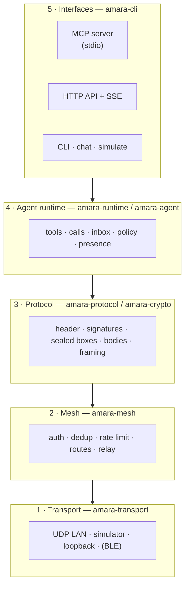
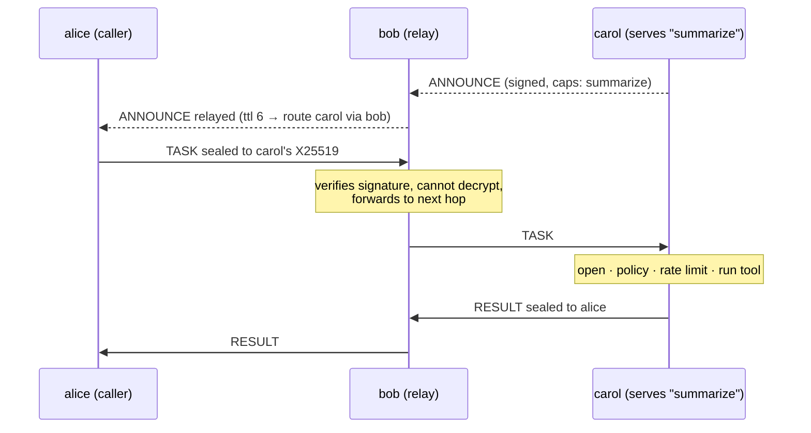

# Architecture

Five layers, each depending only on the layer below. The networking layers know nothing about LLMs; the agent
layer knows nothing about sockets.

## Crates

| Crate | Responsibility |
|---|---|
| `amara-core` | Shared vocabulary: `PeerId`, `PeerInfo`, errors, constants, events |
| `amara-crypto` | Identity, packet signing, sealed boxes, HKDF |
| `amara-protocol` | 42-byte header, packet encode/decode, announce codec, JSON bodies, per-hop framing |
| `amara-transport` | `Transport` trait; `UdpTransport` (feature `udp`), `SimulatedTransport`, `LoopbackTransport` |
| `amara-mesh` | `MeshEngine`: authenticated flooding, learned next-hop routes, peer registry |
| `amara-runtime` | `AgentRuntime`: tools (fn / command / inbox), calls, replies, messages, policy |
| `amara-agent` | Builder SDK: `Agent::builder("nova").tool_fn(..).start()` |
| `amara-cli` | The `amara` binary: MCP server, HTTP API, CLI, chat, setup, simulator, doctor |
| `sdk/python`, `sdk/js` | Zero-dependency clients for the HTTP API |

## Data flow: a tool call over two hops

## Key design decisions

| Decision | Why |
|---|---|
| **Stateless sealed boxes** instead of sessions | Meshes drop and reorder packets; there is no handshake to lose, and every message has a fresh ephemeral key. |
| **Self-certifying announces** | Zero-config trust bootstrap: PeerId = hash(key), so no PKI or prior pairing is needed. |
| **Fragment per hop, below signatures** | Each link uses its own MTU; relays forward whole verified packets. |
| **JSON bodies, binary envelope** | Routing is compact binary; payloads stay readable from Python, JS and any LLM tool chain. |
| **Tools as the capability unit** | Announces list tool names, and schemas are fetched lazily (`amara.card`), which keeps beacons small and LLM context lean. |
| **Inbox tools** | Lets an AI that only speaks MCP (no server of its own) *serve* tools to the mesh. |
| **Mesh ≠ LLM** | The runtime never calls a model. Agents bring their own brains: Claude, Codex, Ollama, a Python script. |

## Testing

* Unit tests in every crate (codecs, crypto, fragmentation, policy, rendering).
* `crates/amara-runtime/tests/mesh.rs` runs multi-node meshes on the deterministic simulator: multi-hop E2E calls,
  capability routing, inbox tools, DMs and broadcasts, trust policy, timeouts.
* `amara-transport` tests real UDP sockets on loopback.
* `amara simulate` is a runnable three-node demo.
